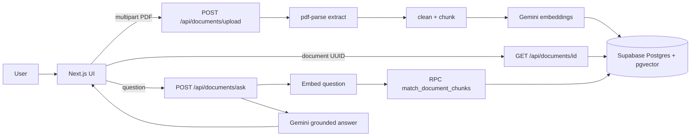

# AskItUp

**Ask your documents. Find the answers.**

AskItUp is an AI document question-answering app: upload a PDF, process it into embedded passages in Supabase, keep a persistent document ID, and ask natural-language questions with page-level citations powered by Google Gemini.

> Access model: **anonymous public demo**. A document UUID is a reference, not authentication. Anyone who has the ID can ask questions about that document.

## Features

- PDF upload with server-side validation (type, size, magic bytes, page/chunk caps)
- Text extraction, cleaning, chunking, and `gemini-embedding-001` embeddings (3072 dimensions)
- Persistent documents and chunks in Supabase (pgvector)
- Copyable document ID + reopen via UUID or `/documents/[documentId]`
- Grounded answers with page citations; clear “not enough evidence” responses
- Shared storage + Gemini usage budgets and IP rate limits
- Resumable processing after partial embedding failures
- Editorial light/dark/system UI (paper & ink) with accessibility-minded controls
- SEO for the landing page; document workspaces are non-indexable

## Architecture



### Design decisions

| Decision | Why |
|----------|-----|
| Service-role Supabase only | Simple MVP; all privileged access stays server-side |
| Public-demo UUID access | No auth yet; documented clearly with rate limits |
| `pending_chunks` JSON | Resume embedding without re-storing the original PDF |
| Fixed `gemini-embedding-001` / 3072-d | Keep query + document vectors in one space |
| Synchronous processing ≤60s | Avoid extra queue infra; resume on timeout/quota |

### Chunking

Default: **2000** characters with **300** overlap per page. Larger chunks → fewer embeddings (cheaper) but coarser retrieval. Smaller chunks → more precise matches but higher embedding usage. Overlap reduces boundary misses.

## Tech stack

- Next.js App Router, React, TypeScript
- Tailwind CSS v4
- `@google/genai` (Gemini)
- Supabase JS (service role) + pgvector
- Zod, Vitest
- `next-themes` for theme preference

## Local development

### Prerequisites

- Node.js 20+
- A Supabase project with the SQL migrations applied
- A Google AI Studio / Gemini API key with embedding + generation access

### Setup

```bash
cd askitup
cp .env.example .env.local
# fill in secrets
npm install
npm run dev
```

Open [http://localhost:3000](http://localhost:3000).

### Environment variables

| Variable | Required | Notes |
|----------|----------|-------|
| `GEMINI_API_KEY` | yes | Server only |
| `GEMINI_EMBEDDING_MODEL` | yes | Must be `gemini-embedding-001` |
| `GEMINI_GENERATION_MODEL` | yes | e.g. `gemini-2.5-flash` |
| `SUPABASE_URL` | yes | Server only |
| `SUPABASE_SERVICE_ROLE_KEY` | yes | Server only — never expose |
| `NEXT_PUBLIC_SITE_URL` | recommended | Canonical / OG / sitemap base |
| `ASKITUP_*` | optional | Limit overrides — see `.env.example` |

## Supabase setup

1. Create a project and enable the `vector` extension (migration does this).
2. **Fresh database:** run `supabase/migrations/001_askitup_schema.sql` in the SQL editor.
3. **Existing AskItUp tables:** run `002_upgrade_existing.sql`, then ensure the RPC functions from `001` exist (`match_document_chunks`, `reserve_chunk_capacity`, `reserve_gemini_budget`, `check_rate_limit`).
4. Confirm `document_chunks.embedding` is `vector(3072)` (or `extensions.vector(3072)`).

If you change the embedding model or dimensions later, **reprocess all documents**. Do not mix incompatible vectors.

## Upload → ask flow

1. User uploads a PDF (≤ 5 MB, ≤ 100 pages, ≤ 300 chunks by default).
2. Server validates and extracts text (no OCR).
3. Shared chunk capacity is reserved atomically when RPCs are installed.
4. Document row is created (`processing`) with `pending_chunks`.
5. Embeddings are generated in batches of 10 and upserted by `chunk_key`.
6. Status becomes `ready`; UI shows copyable UUID.
7. Later questions embed only the question, retrieve top chunks for that UUID, and generate a grounded answer.
8. On failure mid-embed, status is `failed` but stored chunks remain; **Retry** resumes from `pending_chunks`.

## Testing, lint, build

```bash
npm run lint
npm run typecheck
npm test
npm run build
```

Troubleshooting:

- **“Supabase server environment variables are missing”** — set `SUPABASE_URL` and `SUPABASE_SERVICE_ROLE_KEY`.
- **Embedding dimension errors** — confirm model is `gemini-embedding-001` and DB column is 3072-d.
- **RPC missing warnings** — apply migration RPCs; app falls back to softer checks until then.
- **Quota messages** — free Gemini tiers can exhaust; progress is kept when possible; try later.
- **Image-only PDF** — not supported without OCR.

## Vercel deployment

1. Push the `askitup` app (directory with `package.json`) to your Git host.
2. Import the project in Vercel; set Root Directory if the repo nests the app.
3. Configure env vars from `.env.example` (Production + Preview as needed).
4. Set `NEXT_PUBLIC_SITE_URL` to your production URL.
5. Apply Supabase migrations before first production traffic.
6. Deploy. Smoke-test: upload → copy ID → reopen → ask → unsupported question.
7. Watch Gemini quota and Supabase usage; tighten `ASKITUP_*` limits if needed.

**Do not assume “production-ready” solely because `next build` succeeds.** Migrations, secrets, and a live E2E pass are required.

## Quotas, security, operations

- Shared demo caps (defaults): 5 MB PDF, 100 pages, 300 chunks/doc, 1000 chunks global, daily Gemini request budget 400, upload/question hourly rate limits.
- Free Gemini capacity is **not** guaranteed for every user.
- Service role bypasses RLS; protect the deployment URL and keep rate limits on.
- Security headers via middleware; API/document responses are not publicly cached.

## Privacy & retention

- Stored: filename, page count, status, extracted chunk text, embeddings, timestamps.
- Not stored (current MVP): original PDF bytes after the upload request completes.
- Failed/partial jobs keep successful chunks and `pending_chunks` until retry succeeds or you delete the row in Supabase.
- There is no self-serve delete UI yet—operators can `delete from documents where id = …` (cascades chunks).
- Abandoned jobs: operators may delete `failed` rows older than a chosen retention window (e.g. 7–30 days).

## Roadmap

- Optional accounts and private documents
- Self-serve delete + retention jobs
- OCR for scanned PDFs
- Background processing queue for large files
- Richer document history for authenticated users

## Contributing

1. Read `CLAUDE.md` and `SKILLS.md`.
2. Keep changes incremental; update docs when behavior changes.
3. Run lint, typecheck, and tests before opening a PR.
4. Never commit `.env.local` or secrets.

## License

Private project (`package.json` `"private": true`). Add an explicit license before open-sourcing.
# askitup
